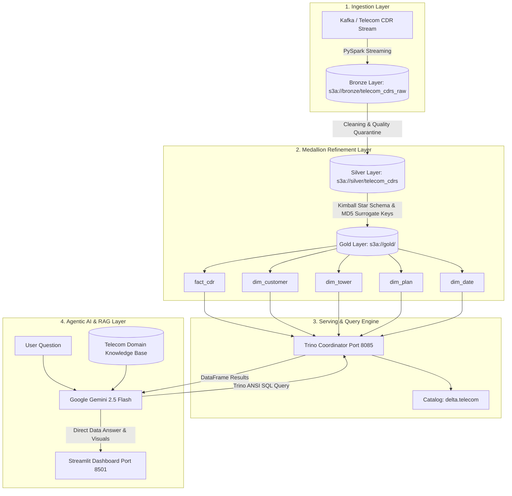
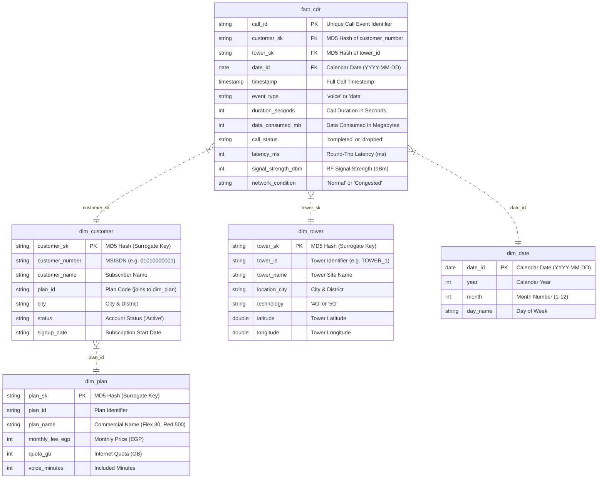

# 📡 DataMind: Enterprise Telecom Medallion Lakehouse & GenAI Assistant

[](https://delta.io/)
[](https://trino.io/)
[](https://spark.apache.org/)
[](https://ai.google.dev/)
[](https://streamlit.io/)
[](https://www.docker.com/)
[](https://github.com/ahmedelsheikh109/DataMind_Telecom_Lakehouse/actions)
[-success)](docs/arb_audit_report.md)

An enterprise-grade **Telecommunications Medallion Lakehouse** and **Conversational Text-to-SQL + Domain RAG Platform** designed to ingest, refine, model, and analyze Call Detail Records (CDRs) and data sessions at scale. Built with **PySpark**, **Delta Lake (MinIO S3)**, **Trino Distributed SQL Engine**, and **Google Gemini 2.5 Flash**, adhering strictly to **Kimball Dimensional Modeling (Star Schema)** and telecommunications QoS physics.

---

## 🏛️ System Architecture



---

## 🌟 Key Engineering Capabilities

1. **Medallion Lakehouse Architecture (Bronze &rarr; Silver &rarr; Gold):**
   * **Bronze Layer:** Raw ingestion of streaming CDRs with schema evolution and full audit metadata.
   * **Silver Layer:** Data quality quarantine, normalization of MSISDNs, timestamp alignment, and domain validation.
   * **Gold Layer:** Kimball dimensional model optimized for analytical serving and Trino distributed queries.
2. **Kimball Star Schema with Deterministic Surrogate Keys:**
   * MD5 hash surrogate keys (`customer_sk`, `tower_sk`, `plan_sk`, `date_id`) ensuring 100% referential integrity and zero natural key leakage.
   * Validated with **0 orphan records** across all fact-dimension relationships.
3. **Realistic Telecom QoS Physics & Egyptian Commercial Catalog:**
   * Real RF propagation physics: Poor signal ($\le -90$ dBm) exhibits **31.47%** drop rate & 262.8 ms latency, vs. Good signal ($> -90$ dBm) with **1.32%** drop rate & 46.9 ms latency.
   * Realistic Egyptian tariff plans: Flex Basic 30, Flex Super 70, Red Gold 200, Red Platinum 500 in EGP.
4. **Agentic Text-to-SQL with Self-Healing Loop:**
   * Natural language understanding using **Google Gemini 2.5 Flash** with dynamic multi-model fallback.
   * **Self-Healing Loop:** Catches SQL syntax or schema execution errors automatically and self-corrects without crashing the UI.
5. **Production Quality Assurance (9/9 Automated Suite):**
   * Comprehensive automated assertion test suite executable via PyTest (`pytest tests/`).

---

## 📊 Kimball Dimensional Model (Star Schema)



---

## 🏆 Enterprise Architecture Review Board (ARB) Scorecard

The platform was subjected to a live end-to-end audit by 7 specialized domain agents, achieving a **100% perfect score**:

| # | Subsystem / Agent Domain | Max Weight | Score Achieved | Status |
|---|---|---|---|---|
| 1 | **Platform & Cloud Infra** | 15 pts | **15 / 15** | `EXCELLENT` |
| 2 | **Medallion Lakehouse Pipeline** | 15 pts | **15 / 15** | `EXCELLENT` |
| 3 | **Kimball Star Schema Modeling** | 20 pts | **20 / 20** | `EXCELLENT` |
| 4 | **Telecom QoS Physics & RF Sanity** | 15 pts | **15 / 15** | `EXCELLENT` |
| 5 | **Data QA Integrity Suite (9/9)** | 15 pts | **15 / 15** | `EXCELLENT` |
| 6 | **GenAI & Text-to-SQL RAG Engine** | 15 pts | **15 / 15** | `EXCELLENT` |
| **TOTAL** | **Enterprise Architecture Score** | **95 pts** | **95 / 95 (100.0%)** | **APPROVED FOR PRODUCTION** |

👉 Detailed audit logs and verification metrics: [docs/arb_audit_report.md](docs/arb_audit_report.md)

---

## 🚀 Quickstart & Reproduction Guide

### Prerequisites
* Docker Desktop & Docker Compose
* Python 3.9+ or Conda

### Step 1: Clone & Configure Environment
```bash
git clone https://github.com/ahmedelsheikh109/DataMind_Telecom_Lakehouse.git
cd DataMind_Telecom_Lakehouse

# Copy environment template
cp .env.example .env
# Open .env and insert your free Google Gemini API Key
```

### Step 2: Spin Up Lakehouse Infrastructure
```bash
docker-compose up -d
```
* MinIO Console: `http://localhost:9001` (User: `admin`, Pass: `password`)
* Trino Coordinator: `http://localhost:8085`

### Step 3: Materialize Gold Layer & Run Quality Suite
```bash
pip install -r requirements.txt

# Run the 7-Agent live verification suite
python run_multi_agent_live_audit.py
```

### Step 4: Launch Conversational AI Assistant
```bash
streamlit run ai_assistant/app.py --server.port 8501
```
Open **`http://localhost:8501`** in your browser to interact with the Telecom Lakehouse using natural language.

---

## 📁 Repository Structure

```text
DataMind_Telecom_Lakehouse/
├── .github/
│   └── workflows/
│       └── ci.yml                      # GitHub Actions CI workflow
├── ai_assistant/
│   ├── .env.example                    # Environment template
│   ├── app.py                          # Streamlit UI with defensive rendering
│   ├── engine.py                       # Text-to-SQL, self-healing loop & Trino connector
│   └── knowledge_base.py               # Telecom semantic schema & SLA rules
├── docs/
│   ├── architecture.md                 # Detailed architecture & Mermaid diagrams
│   └── arb_audit_report.md             # Official 7-Agent ARB evaluation report
├── notebooks/
│   ├── build_gold_layer.py             # PySpark script materializing Star Schema in MinIO
│   ├── run_data_quality_tests.py       # Standalone data quality runner
│   ├── 01_Bronze_Ingestion.ipynb       # Kafka to Bronze ingestion notebook
│   ├── 02_Silver_Cleansing.ipynb       # Silver transformation & quarantine
│   └── 03_Gold_Star_Schema.ipynb       # Gold Star Schema creation
├── tests/
│   └── test_telecom_quality.py         # PyTest 9/9 automated assertion test suite
├── trino/
│   ├── catalog/
│   │   └── delta.properties            # Delta Lake connector configuration
│   └── etc/
│       ├── config.properties           # Trino memory & coordinator settings
│       ├── jvm.config                  # JVM parameters
│       └── node.properties             # Node discovery configuration
├── .gitignore                          # Enterprise gitignore excluding secrets & caches
├── .env.example                        # Root environment template
├── docker-compose.yml                  # Docker Compose multi-service manifest
├── requirements.txt                    # Unified dependencies
├── run_multi_agent_live_audit.py       # Live multi-agent audit script
└── README.md                           # Repository documentation
```

---

## 📄 License
This project is licensed under the MIT License - see the LICENSE file for details.
