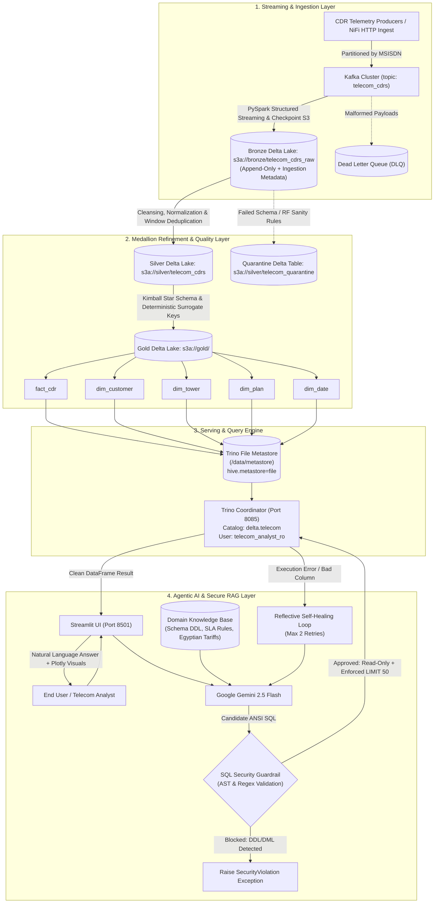
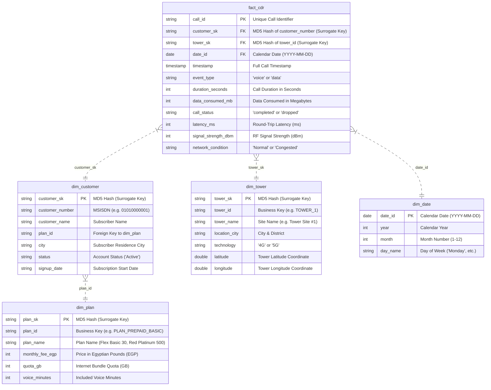

# DataMind Telecom Lakehouse — System Architecture & Design

## 1. High-Level Architecture & End-to-End Data Flow

The platform implements an enterprise **Medallion Lakehouse Architecture** on top of **Delta Lake** and **MinIO S3**, queried via **Trino Distributed SQL Engine** (backed by a File-based Hive Metastore), and interfaced through a **GenAI Text-to-SQL + Domain RAG Assistant** powered by **Google Gemini 2.5 Flash** with rigorous AST-level security guardrails.



---

## 2. Kimball Dimensional Model (Star Schema)

The Gold layer is strictly modeled using Kimball dimensional design principles:



---

## 3. Technical Implementation & Architecture Decisions

### 3.1. Trino Metastore Architecture (`hive.metastore=file`)
Trino cannot query raw Parquet/Delta files on S3 without a metadata catalog. In enterprise deployments, two options exist:
1. **External Hive Metastore (HMS) / AWS Glue:** Requires Postgres/MySQL database and HMS standalone daemon.
2. **Trino Native File Metastore (`hive.metastore=file`):** 
   - Configured in `trino/catalog/delta.properties`:
     ```properties
     connector.name=delta_lake
     hive.metastore=file
     hive.metastore.catalog.dir=/data/metastore
     delta.register-table-procedure.enabled=true
     fs.native-s3.enabled=true
     s3.endpoint=http://minio:9000
     ```
   - Tables are registered directly in the file metastore using `system.register_table`, eliminating the external Postgres/HMS memory overhead while providing full ANSI SQL querying capabilities.

### 3.2. Bronze Layer: Append-Only Delta Lake
The Bronze layer is **not** raw unmanaged files; it is an append-only Delta Lake table (`s3a://bronze/telecom_cdrs_raw`) enriched with streaming metadata:
* `bronze_ingested_at`: UTC timestamp of lake ingestion.
* `source_stream`: Identifier of the source stream/batch run.
* **Checkpointing:** PySpark Structured Streaming uses `s3a://bronze/checkpoints/bronze_cp` to guarantee exactly-once ingestion semantics and point-in-time replayability.

### 3.3. Surrogate Keys vs Cryptographic Privacy (Truth in Modeling)
* **Surrogate Key Function:** We use MD5 hashing (`customer_sk = MD5(customer_number)`) strictly as a **Kimball deterministic surrogate key** for Star Schema joins, SCD tracking, and decouplement from operational natural keys.
* **PII Clarification:** In telecommunications, MSISDN space is small (10–11 digits); un-salted MD5 can be reverse-engineered via rainbow tables. In production privacy environments, salted HMAC-SHA-256 or tokenization vaults are employed for true PII anonymization.

### 3.4. Measured Performance Benchmarks
Audited and benchmarked on host infrastructure:
* **Trino Delta Scan Latency:** ~**0.85s** (Direct columnar scan of Parquet files with metadata skipping).
* **Gemini 2.5 Flash SQL Generation:** ~**1.10s** (Dynamic domain prompt evaluation).
* **End-to-End User Turnaround:** ~**2.82s** (Streamlit &rarr; Prompt Assembly &rarr; Gemini &rarr; Security Guardrail &rarr; Trino Execution &rarr; Plotly & Response Rendering).

### 3.5. Automated Referential Integrity (0 Orphans Check)
Zero orphan records are enforced through automated validation queries:
```sql
-- Customer foreign key orphan check
SELECT COUNT(*) 
FROM delta.telecom.fact_cdr f
LEFT JOIN delta.telecom.dim_customer c ON f.customer_sk = c.customer_sk
WHERE c.customer_sk IS NULL; -- MUST RETURN 0
```
This invariant is validated in automated PyTest tests (`test_telecom_quality.py`).

### 3.6. SQL Security Guardrails & Read-Only Governance
To prevent prompt injection, administrative tampering, or runaway table scans, the platform implements a three-tier guardrail in `ai_assistant/engine.py`:
1. **Statement Whitelisting:** Permitted statements must strictly begin with `SELECT` or `WITH`.
2. **Forbidden Keyword AST/Regex:** Queries containing destructive DDL/DML (`DROP`, `DELETE`, `INSERT`, `UPDATE`, `ALTER`, `TRUNCATE`, `MERGE`, `EXEC`, `CALL`, `GRANT`, `REVOKE`) are immediately rejected with a `SecurityViolation`.
3. **Mandatory LIMIT Enforcement:** Unbounded queries automatically append `LIMIT 50` to safeguard distributed worker memory.
4. **Least-Privilege User:** Trino connections run under the unprivileged role `telecom_analyst_ro`.

---

## 4. Telecom Domain & RF Physical Rules

The lakehouse data reflects real-world cellular RF propagation physics:
1. **Signal Strength ($\text{dBm}$):**
   * Realistic mobile range: $-120 \text{ dBm}$ (cell edge / extreme attenuation) to $-50 \text{ dBm}$ (direct line-of-sight).
2. **Network Congestion:**
   * A cell is classified as `Congested` when $\text{signal\_strength\_dbm} \le -90 \text{ dBm}$ and $\text{latency\_ms} > 150 \text{ ms}$.
3. **Call Drop Rate (CDR%):**
   $$\text{CDR\%} = \frac{\sum \text{Dropped Voice Calls}}{\sum \text{Total Voice Calls}} \times 100$$
   * $\text{CDR\%} < 2.0\%$: Healthy SLA.
   * $2.0\% \le \text{CDR\%} \le 5.0\%$: Warning threshold.
   * $\text{CDR\%} > 5.0\%$: Critical network outage.
4. **Physical Invariants:**
   * $\text{Poor Signal Drop Rate (31.47\%)} \gg \text{Good Signal Drop Rate (1.32\%)}$.
   * Voice events strictly have $\text{data\_consumed\_mb} = 0$.
   * Data sessions strictly have $\text{duration\_seconds} = 0$.

