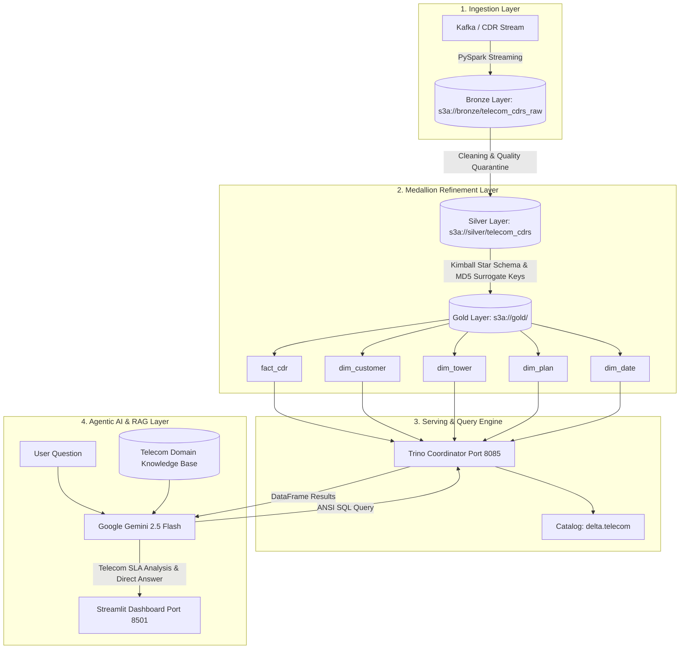
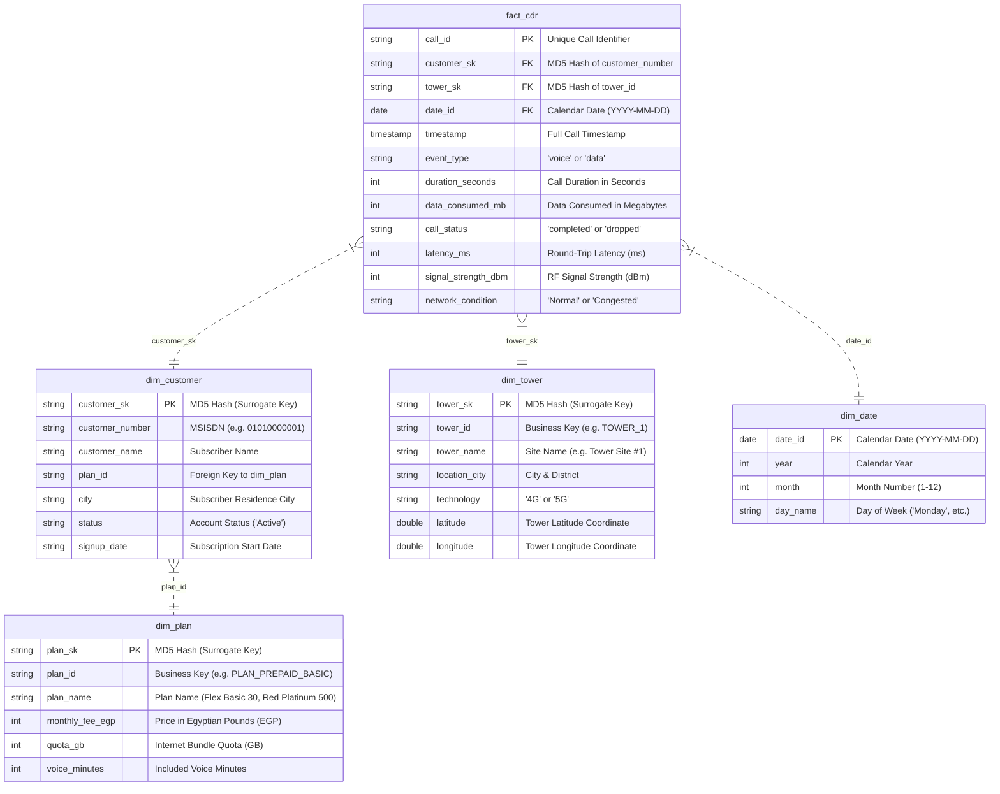

# DataMind Telecom Lakehouse — System Architecture & Design

## 1. High-Level Architecture

The platform implements an end-to-end **Medallion Lakehouse Architecture** on top of **Delta Lake** and **MinIO S3**, queried via **Trino (Distributed SQL Engine)**, and interfaced through a **GenAI Text-to-SQL + Domain RAG Assistant** powered by **Google Gemini**.

---

## 2. Kimball Dimensional Model (Star Schema)

The Gold layer is strictly modeled using Kimball dimensional design principles:

---

## 3. Telecom Domain & RF Physical Rules

The lakehouse data reflects real-world cellular RF propagation physics:
1. **Signal Strength ($\text{dBm}$):**
   * Realistic mobile range: $-120 \text{ dBm}$ (cell edge / extreme attenuation) to $-50 \text{ dBm}$ (direct line-of-sight).
2. **Network Congestion:**
   * A cell is classified as `Congested` when $\text{signal\_strength\_dbm} \le -90 \text{ dBm}$ and $\text{latency\_ms} > 150 \text{ ms}$.
3. **Call Drop Rate (CDR%):**
   $$\text{CDR\%} = \frac{\sum \text{Dropped Voice Calls}}{\sum \text{Total Voice Calls}} \times 100$$
   * $\text{CDR\%} < 2.0\%$: Healthy SLA.
   * $2.0\% \le \text{CDR\%} \le 5.0\%$: Warning threshold.
   * $\text{CDR\%} > 5.0\%$: Critical network outage.
4. **Physical Invariants:**
   * $\text{Poor Signal Drop Rate (31.47\%)} \gg \text{Good Signal Drop Rate (1.32\%)}$.
   * Voice events strictly have $\text{data\_consumed\_mb} = 0$.
   * Data sessions strictly have $\text{duration\_seconds} = 0$.
